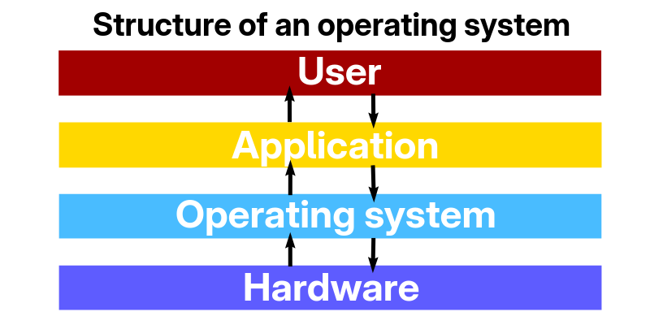

# Should you really switch to Linux in 2026?

**Last update: 17/10/26 – By naplon_**


```
I – Why even consider switching?  
II – The hardware question  
III – For who and why?  
IV – What flavour? (Distro)  
V – Limitations  
VI – Conclusion

EXTRA - A brief introduction to the Linux world
```

> [!CAUTION]  
> This video is not a tutorial on how to install Linux, and it’s not Linux propaganda. It’s just my honest opinion as someone who’s been through this.


## I – Why even consider switching?

#### I.1 Windows

So why do people end up looking at Linux?

For a lot of people, it starts with frustration with Windows.

Windows 11 isn’t necessarily a bad operating system, but over the years it has accumulated a fair amount of criticism:

- Updates that occasionally break things  
- Advertising and recommendations built into the OS  
- AI features being pushed into more and more parts of the system  
- An increasing number of background services and processes  
- Telemetry and privacy concerns  
- Pre-installed applications that many users never asked for  

And then there’s the simple fact that Windows itself isn’t free software.

When you look at Linux, the alternative can feel pretty appealing. Most distributions are free, open source, and give you a lot more control over what is actually installed and running. You can keep a very minimal system with only the software you want. You can customize almost every part of the operating system, and you’re not forced into the same desktop environment, package manager, or interface as everyone else.

But that doesn’t automatically make Linux better.  
And that’s really the point of this video.  
I’m not here to tell you that Linux is superior to Windows. I’m going to walk through the advantages, the disadvantages, and the situations where switching actually makes sense.

#### I.2 – Curiosity

This part is a bit more personal.

When I was around 15, I was using Windows 10 and I actually really liked it. I spent a lot of time tinkering with it, just seeing what I could get the operating system to do.

Then I discovered Kali Linux.  
Kali is a distribution aimed at cybersecurity and penetration testing. To a 15-year-old who had just found it, it looked like the ultimate “hacker” operating system.

So of course I installed it.  
And of course I had absolutely no idea what I was doing.

Kali is not designed as a beginner-friendly desktop system, so I was basically dropped into an operating system I didn’t understand simply because it looked cool.

That curiosity, though, is what actually got me interested in Linux.

My second real experience was with Ubuntu.  
Unlike Kali, Ubuntu is built to be much more accessible for people coming from Windows, and at the time it was one of the easiest ways to get started.

That’s when I began to actually understand what Linux was about.

#### I.3 - Old hardware
When you rely on old hardware Linux seems like a considerable option, unlike Windows it tends to eat less resource on idle and generally runs better on old system because Windows 10 & 11 are heavy in resources. 

First most Linux distro allows you to use their latest version regardless of your hardware, you won't be forced to buy a new computer.
Second drivers that aren't working on Windows anymore usually still work on Linux.
Third they are 'specialized' Linux distro for old hardware, like [antiX](https://antixlinux.com) or even [Tiny core Linux](http://www.tinycorelinux.net/) those distro could probably run on your toaster (really). 

So yes Linux can be a solution for your hardware that Windows decided to call 'obsolete', but it's not a miracle, it's not guarantee that it will save your old hardware.

#### I.4 - Privacy
Now let's speak about privacy. I'm not here to claim Windows spies on you or anything but we all know Windows by default forces telemetry onto your system, officially it's to make Windows better by sending reports to Microsoft which contains your hardware information and many more information. Yes they are ways to disable this telemetry but the fact that you can't disable it during the installation process can be concerning for your privacy. Linux on the other hand has little to zero telemetry, the only real telemetry you can speak about would be [Ubuntu Insights](https://discourse.ubuntu.com/t/ubuntu-insights-how-telemetry-is-changing-on-ubuntu-desktop/73442) BUT it is not forced at all, you can totally choose to not enable it. And as far as I know only Ubuntu has telemetry built-in. 

So if you are concerned about privacy Linux is generally the better choice, if you mostly got nothing to hide then any regular distro with a good browser setup will do the job. But if you deeply care about privacy [Tail os](https://tails.net/) can be a solution as well. 

#### I.5 – Studies

Another common reason for people to use Linux is their studies.

I can take my own case as an example. I study networks and telecommunications, which is mostly hardware-related and can lead to jobs like system administration. A lot of large companies run their servers on Linux, so knowing how it works becomes almost essential.

To keep it short: if your studies aren’t IT-related, it’s fairly unlikely you’ll need to use Linux on a daily basis.

## II – The hardware question

#### II.1 - GPU

If you’re still here, you probably relate to at least one of the reasons I just mentioned. Now let’s talk about hardware compatibility again, based on my own experience.

When I first used Linux on my desktop, everything seemed fine… until I tried installing the NVIDIA drivers. I had an RTX 3060 at the time, and it all went wrong.

I was on Debian (one of the most popular and stable distributions Ubuntu is based on it). Debian has a strong reputation for stability, but it doesn’t ship the proprietary NVIDIA drivers by default. Every time I tried to install them, I managed to break the system. Eventually I gave up on Linux for a while.

Later I bought a Lenovo LOQ 15IRX10 laptop. When I got it, Linux wasn’t even an official option. After getting fed up with Windows 11, I decided to try again.

I started with Debian once more. This time the laptop had an RTX 5050, and installing the drivers still broke the installation. I use a dual-monitor setup, so I needed the NVIDIA drivers for the second screen to work properly — the iGPU alone wasn’t enough.

So I switched to Fedora.

Unlike Debian, Fedora makes it easier to get unofficial NVIDIA packages. To keep it short: NVIDIA’s own drivers are closed-source, meaning only they have the full source code. The Nouveau drivers are the open-source community alternative. Anyone can look at and contribute to that code.

With Fedora and the Nouveau drivers, everything worked out of the box both monitors worked fine. But Nouveau has clear limits: I couldn’t get OBS to record properly, and there was little to no DLSS support. Nouveau is mainly there to get you a working display during and after installation rather than providing full feature support.

> [!Note]  
> You can read more about the differences [here](https://machaddr.substack.com/p/nouveau-vs-nvidia-the-battle-between).

I then installed the proprietary drivers and they worked.

I had a similar experience later with Void Linux. In the end, if you have an NVIDIA GPU, getting it working can still be tricky. It depends on:

- The specific card you have  
- The distribution you choose  
- And, honestly, a bit of luck  

On the AMD and Intel side, things look much brighter. Their GPU drivers are open source, so the code is available for anyone to improve. Because of that, AMD and Intel drivers are pre-installed (or very easy to get) on most distributions. On Debian, for example, you usually won’t have the same headaches.

I’ve only ever owned NVIDIA GPUs, so I can’t claim zero issues with AMD or Intel, but it’s safe to say you’ll generally have a smoother experience.

#### II.2 - Generic Hardware

Unfortunatly having all of your hardwares to work out the box can be a bit tricky, the network / sound card could be missing, the fingerprint scanner may not work etc etc...
Again those situation are very different hardware to hardware and software to software (distribution). Some laptop brand have more drivers support for Linux than others, a nice exemple would be Lenovo, personally I never had any issue with my laptop, and I hardly see people complaining about Lenovo drivers. And of course which distro you choose will make a difference, I will (again) take Fedora as an exemple since this is the distro I currently use and it's the one I've used for the longest. I really had no issues with my drivers on Fedora (GPU exlcuded).

Let's introduce an important aspect of Linux : Desktop environment 
The Desktop environment the graphical interface of Linux, think of it as the desktop, the taskbar and the system app of Windows / Mac. Some of the most popular are:

	- Gnome, which is the one I use who is more of a MacOS style
	- Kde which is the customisation boss, it ressemble Windows
	- XFCE great for an old PC
	- Hyprland a keyboard focused DE for advanced user, customise it to your liking.

They are way more Desktop environment but I only listed the most popular. Some distro ships with their own Desktop Environment, like Linux Mint which ships with Cinamon a Windows like DE great for new user and that's only to cite the most knows.

#### II.3 - Extra hardware

*(Extras: Non-essentials hardware, they are quality of life for the most part, like the fingerprint scanner.)*

Now you may ask yourself 'Why do you use Gnome and not Kde?', well the first reason is look... I am not a fan of how KDE looks overall but that's really personal and taste dependent. Second the great integration of laptop utilities, I can control my keyboard backlight, my power modes from the Gnome control natively, no need to install those annoying third-party apps from your manufacturer which usually sucks... But in the end which DE you use is which fit more of your use case.

To get back to GNOME it also has an overall better integration of the fingerprint scanner, my laptop does not have one sadly but from what I've seen GNOME tends to win on this side. KDE and others stays on the essentials while GNOME is exploring the extras. Don't get me wrong KDE also has fingerprint scanner support but Gnome one is more mature and usually work out of the box.

But that's not true for everything. For exemple webcam and microphone don't necessarily work best on Gnome or KDE, it really depends of the hardware itself rather than the software. So in the end there isn't a good answer to the question of extra hardware.

#### II.4 - Battery life

Now let's speak about the battery life on Linux. It's not necessarily magical, it vary distro to distro and from hardware to hardware. In most case Linux uses less resource than Windows so the battery life goes with it. From my own experience Fedora lightly improve my battery life while Void somehow improved it by a lot.

So once again there isn't a clear answer to the question. It depands of your hardware, distro and use case. For light work such as browsing, watching videos writing a document then Linux would probably improve your battery life. But for heavier task I don't think that's really true. As software tends to be more made and optimized for Windows.

## III - For who and why?

#### III.1 - General peoples

I'm gonna be brutally honest on this one. Linux is not for everyone. If your someone who is absolutely clueless about tech then I don't think Linux in general is a fit for you, tho Linux Mint could be used by anyone but regular distro would be too complicated for you. 
Next if you're a tech enthusiast then go for it, Linux is a huge part in tech. Dualboot your PC. They are plenty of tutorial on how to have Linux and Windows on the same drive so you can enjoy both world.

#### III.2 - Gamers

Then come gamer. If you play any Riot Games (Valorant, LOL, 2XKO), COD's, EA, Apex Legend, Escape from Tarkov, PUBG, R6, GTA then those games and many more won't work on Linux. You can use [ProtonDB](https://www.protondb.com/) to check if the games you play run on Linux. Even if ProtonDB says your game run on Linux it doesn't mean it's gonna be a smooth and flawless experience.  I have experienced issue with games on Linux. For exemple Minecraft runs poorly for me.
I'm also someone that mod my games. Mod tends to use [.dll](https://en.wikipedia.org/wiki/Dynamic-link_library) files, which are Windows API files so on Linux they run poorly safe to say if you have a 40gb mod folder then Linux is not even an option. But *again* the experience is very different from person to person, so try you got nothing to loose in the end.

#### III.3 - Creators 

Then if your someone who use the Adobe Suite, MS Suite, Blender, FL Studio, SolidWork and others then those software are not compatible with Linux, alternative exists but they aren't always good. So check if the software you use are compatible with Linux.

- Adobe Suite -> [ArtCraft](https://getartcraft.com/)
- MS Suite -> [ArtCraft](https://getartcraft.com/) / [Libre Office](https://fr.libreoffice.org/) / [Free Office](https://www.freeoffice.com/en/)
- Blender, SolidWork, CAD -> [FreeCAD](https://www.freecad.org/)
- FL Studio -> [LMMS](https://lmms.io/)

*Note that most of those software ara capable of running on Linux using compatibility software such as* [Wine](https://www.winehq.org/) / [Bottle](https://usebottles.com/) *and* [Proton](https://en.wikipedia.org/wiki/Proton_(software)) *for games. But the performances are usually not optimal.*

## IV - What flavour

## V - Limitation

## VI - Conclusion


## Extra - A brief introduction to the the Linux world
#### EXTRA.1 - The Linux kernel
A question worth asking is what define an operating system and how does it work?

Well I'll answer that and I will try my best to not go into too much technical details and I will try to provide you with a lot of external resources so you can understand everything I'm gonna mention in this video.

So what defines an operating system?



An operating system is the bridge between you and the hardware, to put it simply you open an app that app talks to the operating system which itself talks to hardware for example it tells the CPU to do some operation or the RAM to store this or this....

Now let's introduce an important concept, between the OS and the Hardware sits something we call the 'Kernel'. This kernel has absolute control over your hardware he's the one who talks to the hardware, so why am I mentioned this then? Well Linux is not an Operating System. Linux is a kernel, which mean it does not ship with an Operating System. Every OS works the same way, Windows has the Windows NT kernel which is closed source which mean only Microsoft can access and modify it. That's why there's only 1 lineup of Windows. The Linux kernel is open source which mean anyone can access the code so therefore use it / modify it.

I know it can be confusing so let's try to make this more clear with the notion of 'Distro' or Distributions.

#### EXTRA.2 - Linux distribution & Package manager

Linux distro are the OS, they use the Linux kernel and add an Operating System on top of it, whit users management, applications and everything an OS would need to be qualified as one really. Distro are like flavours there's one for anyone. 

The most popular one being Ubuntu. But as said earlier they are a lot of different distro.
For exemple they are distro who focus on privacy and security, some focus on just working and not breaking on every update and some like to try new things even if it means being unstable. 
If you want to try Linux then my recommendation would be [Linux Mint Cinnamon](https://linuxmint.com/). Which is probably the closest you'd get to Windows. Or try [Fedora Workstation or KDE Plasma Desktop](https://fedoraproject.org/) if you really want to dip into the Linux world without being lost. 
Then if you decide you don't want a boring distro and want a bit of challenge then [Arch](https://archlinux.org/) and [Void](https://voidlinux.org/) are for you!

#### EXTRA.3 - DE & WM
Now let's talk about another import aspect of 

#### EXTRA.4 - Users & File system
#### EXTRA.5 - Unix systems

#### EXTRA.6 - The myth

One of the biggest lie about Linux is :
> "you need to write 10000 lines in the terminal to install a browser."

Well that's wrong for 2 reason. You don't even need to use the terminal to install the browser, you can use [Flathub](https://flathub.org/en) or [Snap](https://snapcraft.io/) which are graphical app stores. So all it takes is one click, so it's even more easy than on Windows! Well I kinda lied because it depands on your browser. Not every browser are on those app stores. But it still doesn't mean you need to become an engineer overnight to install a browser. Which leads us to the second option : using the terminal.

Ok let's install Firefox -> Open my terminal -> type `sudo dnf install firefox`* -> allow the install -> It's installed.

And this work for almost everything. You are not forced to use the terminal to use Linux.

*(dnf is for Fedora based distro only. Commands vary distro to distro. It would be* `sudo apt install firefox` *for Debian/Ubuntu base distro etc etc)*


**Copyright © 2026 Naplon. All rights reserved.**
